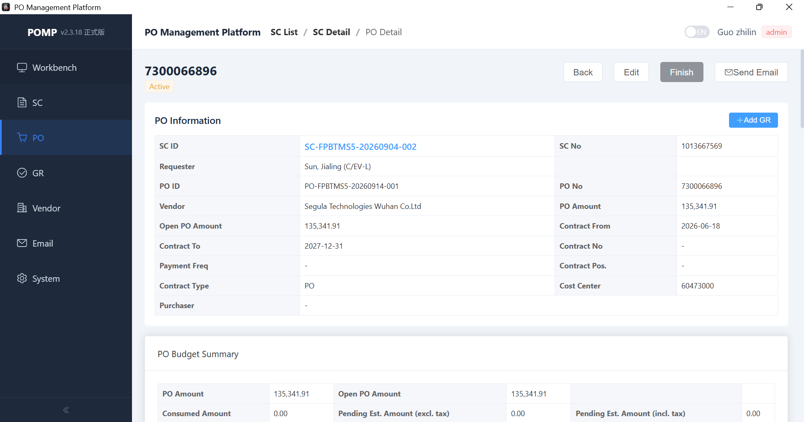
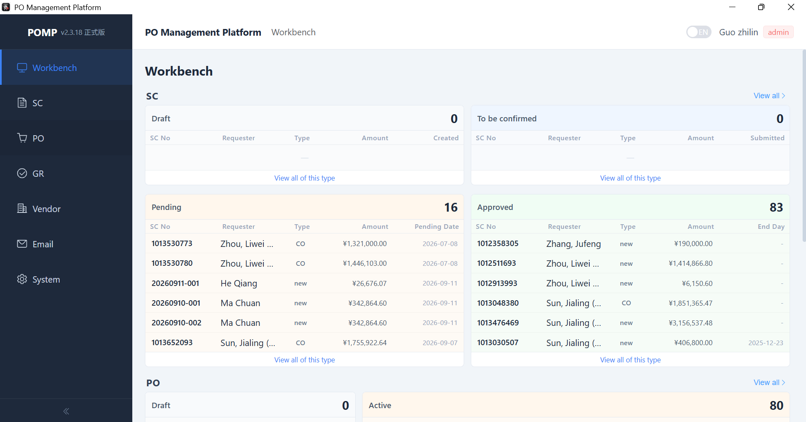
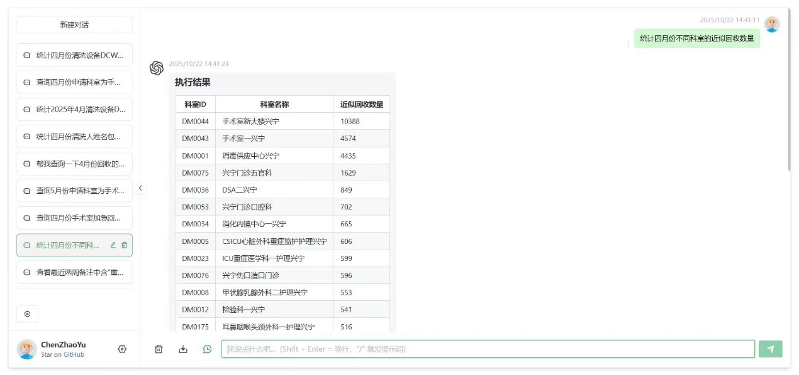
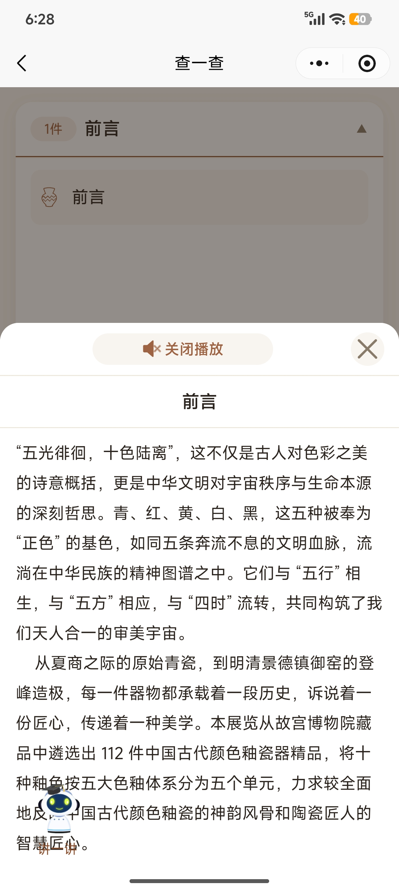
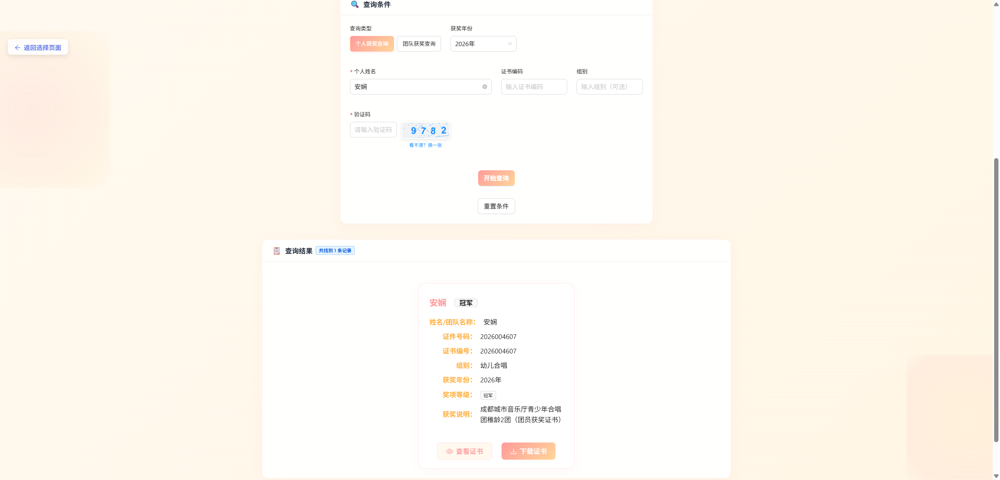
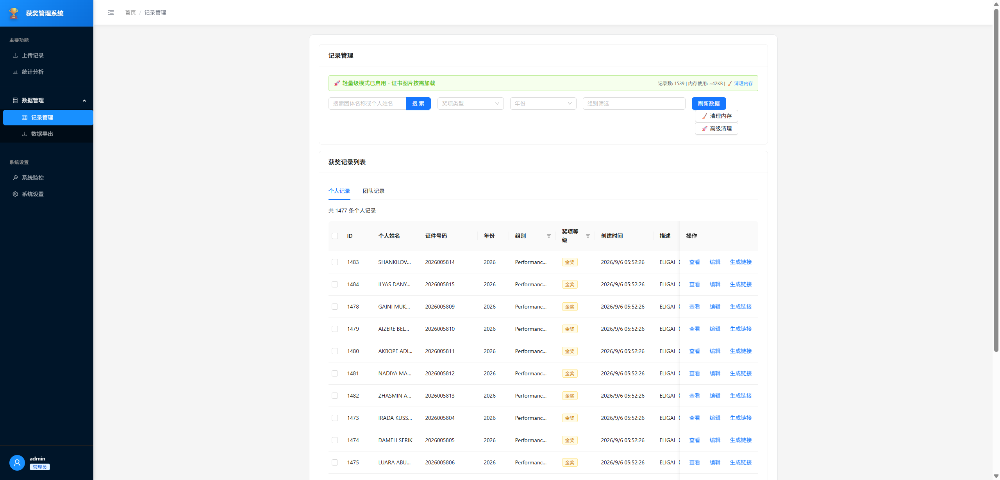
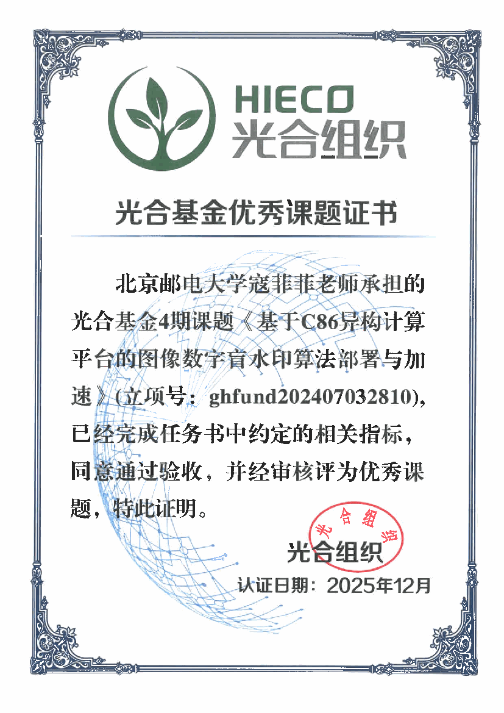

# 作品集整理\-李星辰

# 实习/公司合作项目

## AISHPerf｜芯片与大模型训练、推理评测平台 \| 智能体、算法、评测

北京电信／中国信通院项目 · 2026\.07—2026\.09 · 大模型算法工程师（实习） · 平台已支持实际评测

算力选型部分测试地址：http://61\.172\.167\.201:5340/

Gitee开源地址：https://gitee\.com/aishperf\-caict/aishperf\_openness

项目背景：**让“模型能否在某款芯片上运行、运行表现如何”有实测依据。** AISHPerf 面向不同芯片、模型与运行框架，实际执行训练和推理任务，产出完整评测数据，支持任务管理、结果对比与适配验证，为算力选型提供参考。

工作内容：在团队建设的平台中，我主要负责**持续数据采集与算力选型智能体**，将分散的芯片、模型和评测信息转化为可查询、可用于推荐的数据。

- **持续更新数据**：基于 Hermes Agent 编排来源发现、数据采集、信息提取与入库流程，通过心跳机制持续执行；累计获取芯片信息 **1,093 项**、模型信息 **1,370 项**及评测数据 **3,517 条**。

- **支持对话式选型**：针对训练、推理和量化等场景，设计评分与资源预估方法，提供芯片推荐、显存需求与卡数估算，并展示推荐理由。

- **让智能体调用业务能力**：使用 Python 封装查询、录入与推荐的 CLI／API，配套编写 Skills，使自然语言需求能够调用明确的业务操作。

**核心技术栈**：Python · Hermes Agent · 多智能体协作 · Skills · CLI／API · 算力选型算法

*平台评测总览：集中呈现训练、推理及专项评测任务。*

*算力选型：按模型与使用场景给出推荐理由、显存需求及卡数估算。*

---

## POMP｜基于共享盘的奥迪采购与预算协作系统 \| 开发、协作

奥迪 C/EV\-L 测试车辆研发部门实习 · 2026\.04—2026\.07 · 软件开发 · 已发布正式版，奥迪内部实装使用

项目背景：此前奥迪公司依靠 **Excel 管理采购预算、订单和费用，人工维护效率低、容易出错**。POMP 将业务记录、金额校验和邮件提醒整合到同一系统，帮助协作人员跟踪采购进度与剩余预算，并衔接外部财务审批流程。

**由于公司政策问题，无法部署应用服务器，只能依靠共享盘协作使用**，是项目的核心限制。系统采用 Windows 桌面客户端访问共享盘数据库，在现有办公环境中实现多人使用。

工作内容：我完整负责项目的从零开发直至上线使用。包括管理员/用户角色区分、采购、合同与供应商相关功能及邮件通知开发，重点解决共享盘条件下的业务整合、金额一致性与多人协作问题。

- **贯通业务与金额规则**：围绕预算分配、订单执行和费用申请组织流程，关联供应商及合同信息，使业务状态与可用金额保持一致。

- **处理共享盘上的多人写入冲突**：将 SQLite 数据库存放在共享盘，结合带心跳与过期机制的文件租约锁和数据库事务，在提交时重新读取状态并校验额度，防止多人基于旧余额操作造成超额占用；关键变更同步记录审计日志。

- **完成桌面交付与通知自动化**：结合 Vue 与 Python 构建桌面界面，接入 Outlook 流程通知及到期、预算提醒，并提供安装包交付。

**效果与落地**：系统已发布正式版，实习结束前实际使用人数达到 **70\+**，累计产生流程自动邮件 **900\+ 份**。

**核心技术**：Python · Vue 3 · pywebview · SQLite · 事务与租约锁 · Outlook 自动化

*采购订单列表集中展示订单状态、申请人及供应商，支持检索与跟踪。*

*订单详情关联采购信息与预算摘要，便于核对金额。*

*工作台，用于查看当前运行中的流程。*

---

## 新华医疗｜手术器械管理系统自然语言查询智能体

课题组与新华医疗合作项目 · 2025\.05 启动 · 项目负责人兼算法研发

项目背景：新华医疗为医院提供手术器械解决方案及配套管理系统。客户的查询需求经常变化，开发人员需要不断适配特定需求的 SQL，处理大量零散的小需求。项目让使用者通过自然语言完成查询与统计，减少日常查询对开发适配的依赖。

例如，“查询 2024 年 5—7 月手术包出入库情况，并按出库人员统计月均使用数量”，可拆成两项查询，分别生成 SQL、执行并解释结果。

工作内容：我负责查询架构、智能体编排与检索优化，并行探索**上下文工程与多智能体两类方案**，均已落地使用。

- **组织复杂数据库知识**：针对百余张表、缺少外键和字段注释的业务数据库，梳理业务域与表间关系，结合混合 RAG 提供相关结构和查询样例，减少无关信息对 SQL 生成的干扰。

- **复用业务查询能力**：将视图构建与日常查询分离，常规需求优先复用语义视图；未覆盖的需求交由多智能体完成意图拆解、结构规划、SQL 编写与审查，兼顾查询效率和复杂需求处理。

- **连接业务规则与执行工具**：将查询规则组织为 Skills，通过 CLI 工具衔接数据库操作，支持多需求拆解、查询与结果解释，并完成内网本地化部署。

**效果与落地**：查询准确率由 **32% 提升至 84%**，结合检索优化，整体正确率达 **94%**，目前在山东数家医院试点优化。

**核心技术栈**：Python · LangGraph · 混合 RAG · SQL Server · Skills／CLI · Qwen · vLLM

*输入“统计四月份不同科室的近似回收数量”，返回分科室统计结果。*

---

## 奥迪｜车辆电检报告智能诊断平台

奥迪 C/EV\-L 测试车辆研发部门 · 2026\.04—2026\.07 · 智能体应用开发

开源地址：https://github\.com/bupt\-lxc/AIVehicleDiagnose

项目背景：工程师原本需要人工查看电检报告、检索故障码并结合经验判断原因。面对大量故障信息，即使查到知识，仍难以快速判断真正的根因。

平台接收电检报告与故障描述，输出包含**故障表现、疑似根因、支持证据与排查建议**的完整报告，为工程师提供进一步排查的依据。

工作内容：我负责数据预处理、知识库与 RAG 检索，以及多智能体诊断流程开发，将报告处理、知识检索和根因分析衔接起来。

- **提炼有效诊断信息**：开发电检报告预处理 Skill，结构化提取故障码、控制单元状态等关键信息，减少冗余内容，使 Agent 上下文减少 **35% 以上**。

- **为根因分析提供知识依据**：构建诊断知识库与混合 RAG，将报告中的故障信息与相关知识关联，辅助智能体解释故障现象、比较疑似原因并组织证据；Top\-5 召回率提高 **37 个百分点**。

- **支持交互式协作诊断**：在输入后直接生成报告的端到端流程之外，基于 Agent＋Skills 实现协作式诊断。智能体可反问缺失信息，工程师也可补充现象或继续追问，使分析随交互逐步完善。

**核心技术栈**：Python · LangGraph · 多智能体协作 · Skills · 混合 RAG · 诊断知识库

---

## 华小博｜拍照识别与 AI 讲解微信小程序

**华小博（北京）科技有限公司合作项目 · 2025 年至今 · 项目负责人兼后端开发 · 已上线并落地应用**

项目背景：博物馆展品陈列密集，传统导览定位不够准确，容易出现眼前展品与讲解内容不对应的问题。华小博让观众通过微信小程序拍摄展品或展牌获取讲解，也可搜索展品、向 AI 提问，将现场参观与知识问答连接起来。

项目的关键是**先找对展品，再提供对应讲解**，尤其需要解决外观相似展品难以区分的问题。

工作内容：我负责后端服务架构、展品检索与 RAG 智能讲解开发，支撑小程序的拍照、搜索和对话入口。

**构建多路展品检索**：结合图像特征匹配、展牌 OCR 与搜索查询连接展品资料；针对相似展品容易混淆的问题，加入展牌文字识别兜底，降低单一路径识别失败对使用体验的影响。

- **开发智能讲解服务**：基于 RAG 对接展品知识库与联网检索工具，通过异步处理支持讲解生成和个性化问答；将对话、OCR 与图像匹配拆分为独立服务，便于分别维护与优化。

- **优化高频查询性能**：通过 CDN、JVM 本地缓存与 Redis 多级缓存承接高频资源和展品查询，结合缓存防击穿策略应对集中访问，使核心查询类接口响应时间控制在 **100 ms 以内**。

**效果与落地**：已在通州博物馆等 **12** **处场馆**落地，覆盖展品 **700 余件**，累计服务用户 **超过 4,000 人**。

**核心技术**：Java · Python · RAG · OCR · 图像特征匹配 · Redis · 多级缓存

---

## 保利剧院合作｜国际赛事获奖查询与证书管理系统

深圳市保利剧院演出经营有限公司合作项目 · 2026\.02—2026\.04 · 独立全栈开发与部署运维 · 已落地使用 6 个月

项目背景：面向国际赛事的获奖信息查询与证书管理需求，为主办方和参赛个人、团体提供在线服务。系统支持按姓名、团体、年份等条件查询获奖记录，查看与下载证书，并通过管理后台维护赛事数据，服务范围覆盖中国大陆、香港，以及俄罗斯和东亚、欧洲等多个国家与地区。

工作内容：我独立负责需求梳理、前后端开发、数据库设计及上线运维，完成从业务功能到公网服务的完整交付。

- **打通查询与管理流程**：基于 Vue 3 与 Go／Gin 开发公开查询端和管理后台，支持个人及团体获奖查询、证书查看下载、记录批量录入与维护，让赛事数据录入后能够直接用于对外查询。

- **完成公网部署与资源分发**：完成域名备案及部署，配置 Nginx 负载均衡、CDN 与对象存储，分别承接业务请求和证书等静态资源访问，支撑多地区用户使用。

- **支撑持续运行与维护**：实现管理员身份认证、数据统计及运行监控，配合证书图片按需加载，兼顾日常数据维护和页面访问体验，并持续承担上线后的维护工作。

**效果与落地**：约 2 个月完成开发，已落地使用 **6 个月**，累计使用人数 **超过 1,100 人**，录入信息 **1,400\+ 条**。

**核心技术**：Go · Gin · GORM · MySQL · Vue 3 · Ant Design Vue · Nginx · CDN · 对象存储

*查询获奖记录，查看奖项、组别及证书信息，并支持证书查看与下载。*

*管理后台统一维护个人与团体获奖记录，支持条件筛选与记录编辑。*

---

## 超算互联网｜海光 DCU 图像水印部署与推理优化

**光合基金合作项目 · 主要开发期约 2025\.03—2025\.09 · 模型适配与工程交付 · 已结项，获评优秀课题**

项目背景：图像数字水印用于在不明显改变图像观感的情况下嵌入、提取版权标识。项目将原运行于 NVIDIA GPU 的深度学习水印模型迁移至国产海光 DCU，优化推理性能，并通过超算互联网平台提供使用，完成从模型适配到可交付软件的落地。

工作内容：我负责模型适配、运行环境部署、算子与推理优化，以及性能测试和软件交付。

- **完成国产算力适配**：基于 TensorFlow 与海光 DTK 环境迁移水印编解码模型，支持两种图像分辨率，验证迁移后的图像质量与水印提取正确性。

- **优化算子执行与推理流程**：启用 XLA 编译融合算子，减少核函数启动开销；结合批处理与异步数据加载，提高并行利用率，减少推理调用和数据等待。

- **交付平台服务**：完成软件封装、部署镜像与使用文档，镜像上架超算商城，并完成性能测试及三家单位的示范应用。

**优化效果**：移植优化测试中，**1080p 图像单 DCU 水印编码耗时由 1\.12 秒／图降至 0\.20 秒／图，加速 5\.6 倍**。

**成果与认可**：项目通过验收，于 **2025 年 12 月获评“光合基金优秀课题”**。

**核心技术**：Python · TensorFlow · 海光 DCU／DTK · XLA · 批处理与异步加载 · 容器部署

---

## 中国移动九天｜大模型多轮对话安全对齐

**中国移动九天 AI 研究院 · 2026\.01—2026\.04 · 大模型安全可信实习生 · 相关论文已发表，专利已申请**

项目背景：多轮对话中的风险会随交互逐步显现。项目通过跨轮风险定位与强化学习优化，提升模型应对多轮攻击的能力，同时减少对正常问题的不必要拒答。

工作内容：我负责跨轮风险定位、分支采样策略与加权 GRPO 优化，并完成对比实验及专利技术交底。

- **聚焦关键风险轮次**：训练轻量级 DeBERTa 风险判别模型，定位对话中的关键风险输入，设计风险感知分支采样策略，使训练更有针对性地覆盖风险位置。

- **优化安全对齐训练**：将风险强度与判别置信度引入 GRPO 加权更新，并对比多种安全对齐方法，兼顾有害输出抑制与正常请求响应。

**实验成果**：风险感知采样使攻击成功率下降 **5\.9 个百分点**；加权 GRPO 使刻板拒答率下降 **3\.8 个百分点**、有害率下降 **1\.6 个百分点**。相关论文已发表，专利已申请。

**核心技术**：Python · PyTorch · Agentic RL · DeBERTa · GRPO

