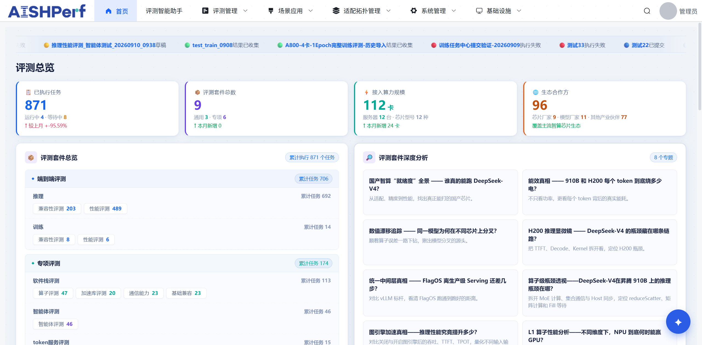
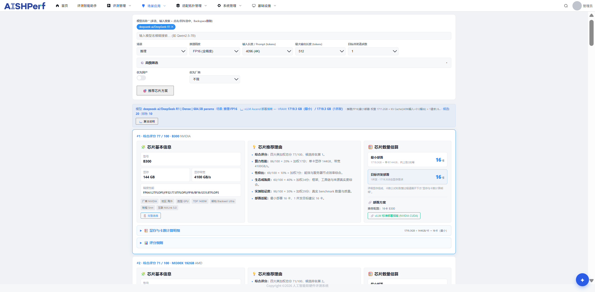

---
{
  "slug": "aishperf",
  "title": "AISHPerf｜异构评测与算力选型智能体",
  "context": "北京电信／中国信通院项目",
  "period": "2026.07—2026.10",
  "summary": "连接异构算力实测、持续数据采集与对话式选型，让芯片与模型的选择有数据依据。",
  "role": "评测框架核心开发；算力选型智能体 Owner",
  "outcomes": [
    {
      "id": "batch-duration",
      "text": "固定评测矩阵下，批次完成耗时 42h → 17h",
      "emphasis": "42h → 17h"
    },
    {
      "id": "benchmark-data",
      "text": "1,093 条芯片信息 · 1,370 条模型信息 · 3,517 条 Benchmark 记录",
      "emphasis": "3,517 条 Benchmark 记录"
    }
  ],
  "tags": [
    "Python",
    "vLLM / CANN",
    "Celery",
    "Hermes Agent",
    "Skills"
  ],
  "order": 1,
  "links": [
    {
      "label": "评测框架源码",
      "url": "https://gitee.com/aishperf-caict/aishperf_openness"
    },
    {
      "label": "选型智能体源码",
      "url": "https://github.com/bupt-lxc/chip-recommend"
    },
    {
      "label": "选型测试入口",
      "url": "http://61.172.167.201:5340/"
    }
  ],
  "cover": "../../assets/projects/aishperf-overview.png",
  "coverAlt": "AISHPerf｜异构评测与算力选型智能体项目截图",
  "primaryCapability": "training-inference",
  "secondaryEvidence": [
    {
      "capability": "agents",
      "title": "算力选型智能体",
      "summary": "将持续采集的芯片、模型和评测数据接入工具调用与对话式选型流程。",
      "anchor": "agent-selection"
    }
  ],
  "card": {
    "contributions": [
      "核心开发异构评测调度、执行适配与推理调优",
      "独立负责持续数据采集与算力选型智能体"
    ],
    "primaryOutcomeId": "batch-duration",
    "secondaryOutcomeId": "benchmark-data",
    "tags": [
      "Python",
      "vLLM / CANN",
      "Celery"
    ],
    "sourceLinkIndex": 0
  }
}
---

## 项目背景

AISHPerf 面向华为昇腾／NVIDIA 等异构平台的模型与运行框架，实际执行评测任务，输出性能画像与推荐配置。我在团队平台中承担两个边界明确的工作方向：评测调度与执行适配的核心开发，以及算力选型与持续数据采集智能体的从零设计、落地。

## 异构评测：调度与执行适配

- **统一评测框架**：承接上游 Suite 定义的规则、场景与指标，封装环境预检、容器命令执行、模型服务启动与就绪检查、评测调用及报告解析。对接 vLLM／CANN，覆盖模型兼容性、算子精度／性能及 HCCL 通信评测，统一执行与指标归一化，覆盖 **3 种芯片、24 个模型版本**。
- **异构异步执行**：基于 Celery＋Redis Broker、Task Routing／Worker Pool，按硬件能力与框架依赖路由任务，结合设备隔离、并发及预取控制。在固定评测矩阵下，批次完成耗时由 **42h 缩短至 17h**，有效评测吞吐由 **4 Case/h 提升至 14 Case/h**。
- **推理性能调优**：通过 Batch Auto-Tuning 搜索 batch_size 上限，结合 Token Throughput、P95 TTFT／TPOT 与显存约束识别吞吐饱和区，形成性能画像及推荐配置。在 **910B＋DeepSeek-v4-flash** 配置下，保持输出吞吐不降，相对默认配置总显存需求降低 **46%**。

## 算力选型：持续采集与对话式推荐

此部分由我作为项目 Owner 完全负责，从持续数据采集智能体到算力选型推荐智能体完成从零设计与落地。

- **持续更新数据**：基于 Hermes Agent＋Heartbeat，编排来源更新、网页采集、结构化提取与录入，累计收录 **1,093 条芯片信息、1,370 条模型信息、3,517 条 Benchmark 记录**。
- **业务工具调用**：使用 Python CLI／API＋Agent Skill 封装 Query／Ingest／Scoring 接口及调用规范。通过评分工具设计，平均工具调用轮次由 **26 次降低为 7 次**。
- **选型引擎**：面向 Training／Inference／Quantization，设计 **3 大维度、7 项评分**的推荐算法，输出 VRAM Estimation、卡数估算、候选排名与评分依据。在 **7 组部署样本**上，显存估算平均误差控制在 **20% 以内**。

## 平台截图

*平台评测总览：集中呈现训练、推理及专项评测任务。*

*算力选型：按模型与使用场景给出推荐理由、显存需求及卡数估算。*

## 技术栈

Python · vLLM · CANN · Celery · Redis · Hermes Agent · Skills · CLI／API

