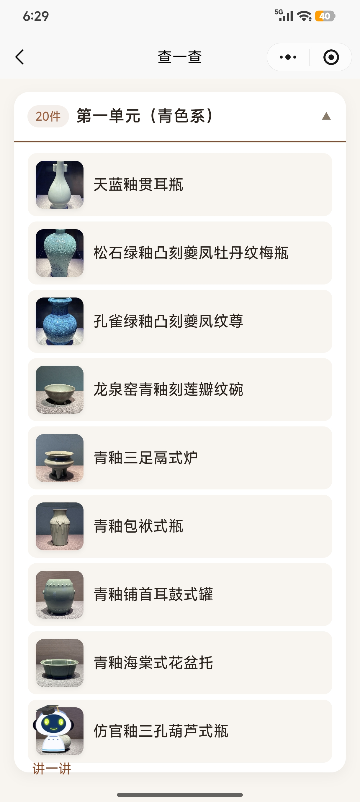

---
{
  "slug": "huaxiaobo",
  "title": "华小博｜拍照识别与 AI 讲解小程序",
  "context": "华小博（北京）科技有限公司合作项目",
  "period": "2026.01—2026.07",
  "summary": "通过图像识别、候选确认和展签 OCR 找对展品，再以 RAG Agent 提供讲解与问答。",
  "role": "项目负责人；后端架构、展品检索与 RAG 讲解",
  "outcomes": [
    {
      "id": "venue-users",
      "text": "落地 11 处场馆 · 累计服务 6000 余名用户",
      "emphasis": "6000 余名用户"
    },
    {
      "id": "query-latency",
      "text": "核心查询类接口响应时间 100 ms 以内",
      "emphasis": "100 ms 以内"
    }
  ],
  "tags": [
    "Java",
    "Python",
    "RAG Agent",
    "OCR",
    "Redis"
  ],
  "order": 5,
  "links": [],
  "cover": "../../assets/projects/huaxiaobo-exhibits.jpg",
  "coverAlt": "华小博｜拍照识别与 AI 讲解小程序项目截图",
  "primaryCapability": "fullstack",
  "secondaryEvidence": [
    {
      "capability": "agents",
      "title": "华小博 RAG 讲解",
      "summary": "从展品识别、知识检索到讲解生成与个性化问答。",
      "anchor": "rag-guide"
    }
  ],
  "card": {
    "contributions": [
      "负责后端架构与图像、OCR 多路展品检索",
      "交付 RAG 讲解与问答，以多级缓存优化高频查询"
    ],
    "primaryOutcomeId": "venue-users",
    "secondaryOutcomeId": "query-latency",
    "tags": [
      "Java",
      "RAG Agent",
      "Redis"
    ]
  }
}
---

## 项目背景

博物馆展品陈列密集，传统导览定位不够准确，容易出现眼前展品与讲解内容不对应的问题。华小博让观众通过微信小程序拍摄展品或展牌获取讲解，也可搜索展品、向 AI 提问，将现场参观与知识问答连接起来。

项目的关键是**先找对展品，再提供对应讲解**，尤其需要解决外观相似展品难以区分的问题。

## 工作内容

我负责后端服务架构、展品检索与 RAG 智能讲解开发，支撑小程序的拍照、搜索和对话入口。

**构建多路展品检索**：结合图像特征匹配、展牌 OCR 与搜索查询连接展品资料；针对相似展品容易混淆的问题，加入低置信度 Top-5 候选确认与展牌文字识别兜底，降低单一路径识别失败对使用体验的影响。

- **开发智能讲解服务**：基于 RAG 对接展品知识库与联网检索工具，通过异步处理支持讲解生成和个性化问答；将对话、OCR 与图像匹配拆分为独立服务，便于分别维护与优化。

- **优化高频查询性能**：通过 CDN、JVM 本地缓存与 Redis 多级缓存承接高频资源和展品查询，结合缓存防击穿策略应对集中访问，使核心查询类接口响应时间控制在 **100 ms 以内**。

## 效果与落地

已在通州博物馆等 **11 处场馆**落地，覆盖展品 **700 余件**，累计服务 **6000 余名用户**。

## 核心技术

Java · Python · RAG · OCR · 图像特征匹配 · Redis · 多级缓存

在国博瓷器展测试中，Top-5 召回率达 **92%**，OCR 辅助条件下达 **97%**。

