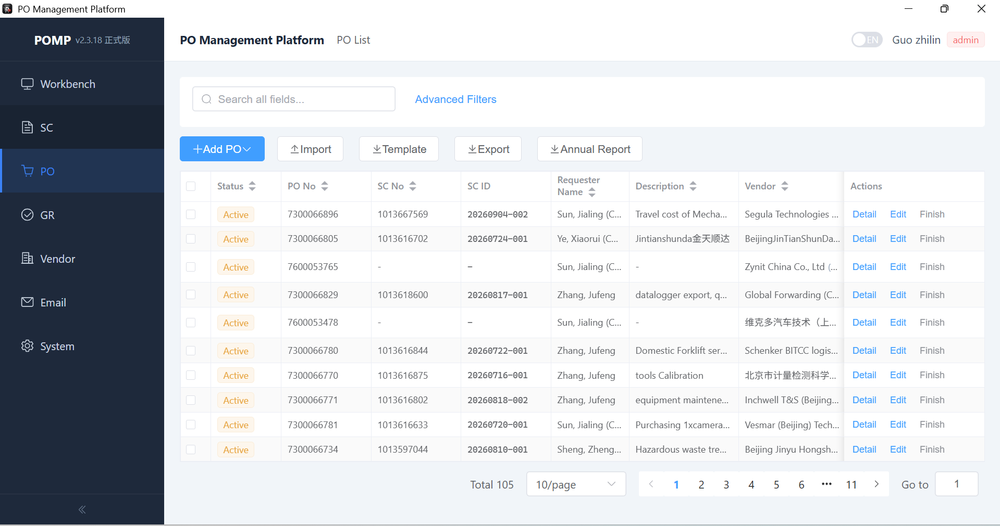

---
{
  "slug": "pomp",
  "title": "POMP｜共享盘采购与预算协作系统",
  "context": "奥迪 C/EV-L 测试车辆研发部门",
  "period": "2026.04—2026.07",
  "summary": "在无应用服务器、仅共享盘的办公环境中，贯通采购、合同、供应商与预算协作。",
  "role": "独立完成从零开发与桌面交付",
  "outcomes": [
    "累计服务 170+ 用户",
    "自动 Outlook 业务邮件 4500+ 封"
  ],
  "tags": [
    "Python",
    "Vue 3",
    "pywebview",
    "SQLite",
    "Outlook"
  ],
  "order": 2,
  "links": [
    {
      "label": "项目源码",
      "url": "https://github.com/bupt-lxc/contract"
    }
  ],
  "cover": "../../assets/projects/pomp-orders.png",
  "coverAlt": "POMP｜共享盘采购与预算协作系统项目截图"
}
---

## 项目背景

此前奥迪公司依靠 **Excel 管理采购预算、订单和费用，人工维护效率低、容易出错**。POMP 将业务记录、金额校验和邮件提醒整合到同一系统，帮助协作人员跟踪采购进度与剩余预算，并衔接外部财务审批流程。

**由于公司政策问题，无法部署应用服务器，只能依靠共享盘协作使用**，是项目的核心限制。系统采用 Windows 桌面客户端访问共享盘数据库，在现有办公环境中实现多人使用。

## 工作内容

我完整负责项目的从零开发直至上线使用。包括管理员/用户角色区分、采购、合同与供应商相关功能及邮件通知开发，重点解决共享盘条件下的业务整合、金额一致性与多人协作问题。

- **贯通业务与金额规则**：围绕预算分配、订单执行和费用申请组织流程，关联供应商及合同信息，使业务状态与可用金额保持一致。

- **处理共享盘上的多人写入冲突**：将 SQLite 数据库存放在共享盘，结合带心跳与过期机制的文件租约锁和数据库事务，在提交时重新读取状态并校验额度，防止多人基于旧余额操作造成超额占用；关键变更同步记录审计日志。

- **完成桌面交付与通知自动化**：结合 Vue 与 Python 构建桌面界面，接入 Outlook 流程通知及到期、预算提醒，并提供安装包交付。

## 效果与落地

系统已发布正式版，累计服务用户达到 **170+**，累计产生流程自动邮件 **4500+ 封**。

## 核心技术

Python · Vue 3 · pywebview · SQLite · 事务与租约锁 · Outlook 自动化

*采购订单列表集中展示订单状态、申请人及供应商，支持检索与跟踪。*

*订单详情关联采购信息与预算摘要，便于核对金额。*

*工作台，用于查看当前运行中的流程。*
